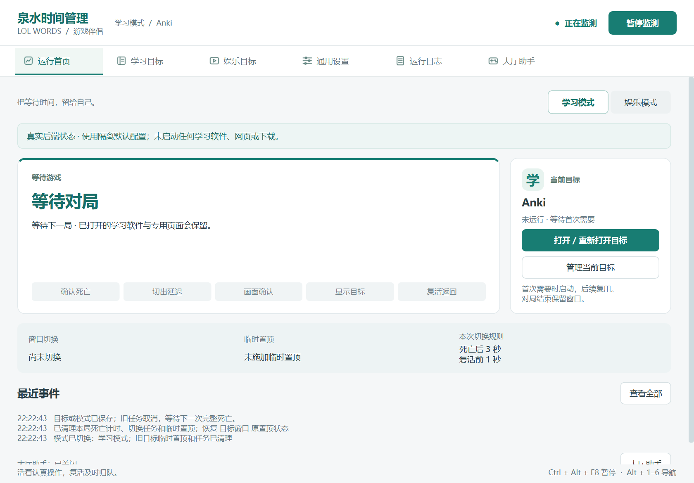

# Windows 桌面版说明

## 游戏伴侣风格

2026-10-19 按选定的“轻量游戏伴侣风”落地真实 Qt 界面：

- 顶部品牌、模式 / 目标、监测状态与暂停操作始终可见，六个页面使用横向导航；方向键与 Alt + 1–6 可切换。
- 首页左侧突出当前流程、等待原因和接口提供的复活倒计时；右侧集中显示当前目标及打开、管理操作。
- “确认死亡 → 切出延迟 → 画面确认 → 显示目标 → 复活返回”只标出后端确认的当前阶段；取消、暂停与接口异常时清除标记，不伪造完成百分比。
- 窗口切换、临时置顶、本次切换规则分开显示；运行中仍展示实际生效的配置快照，避免把刚保存但未应用的参数误当作当前规则。
- 保持浅灰白与蓝绿色；窄窗口自动将目标面板移到流程下方，普通界面不新增内部事件入口。
- 修复 Qt 数字输入框在无按钮样式下编辑区域宽度异常的问题，恢复可见数值、微调按钮与键盘输入。



## 大厅助手更新

新增第六页“大厅助手”，三个自动功能默认关闭，独立保存并即时生效；全局暂停与退出同时取消大厅任务。正常返回、跳过结算和右上头像回首页的识别依据与验证边界见 [LOBBY.md](LOBBY.md)。

若客户端以管理员权限运行、工具无法取得连接参数，大厅页会显示权限差异及管理员重启按钮。此入口保留已保存配置，先清理旧任务，再通过 Windows 授权打开同目录的新窗口；新窗口先暂停、只读检查连接。也可运行 `start-admin.cmd`。取消授权不关闭原工具、不恢复自动操作。

## 使用方式

1. 安装 Windows 10/11 64 位上的 **Python 3.14 64 位**。运行包附带项目依赖，但不附带 Python 解释器。
2. 解压到独立目录，退出旧版本工具，双击 `start.cmd`。源码包首次使用先运行 `install.cmd`。
3. 可双击 `app.pyw` 使用无控制台入口，前提是系统已将 `.pyw` 关联到 Python。启动错误会显示 Windows 提示并写入本机 `startup-error.log`。
4. 默认自动监测，学习目标为 Anki。目标首次满足安全切出条件时才自动启动；“打开 / 重新打开目标”为用户主动打开入口。
5. 暂停快捷键仍为 **Ctrl + Alt + F8**。导航可使用 **Alt + 1–6**；各控件支持 Tab 切换，日志页支持 Ctrl + C 复制所选行。

正常桌面界面不需要 Tk。为保留旧界面回归基线，执行全部测试时仍需 Python 官方发行版附带的 Tk。

依赖锁定在 `requirements.txt`：PySide6-Essentials / shiboken6 6.12.0，以及原有 DXcam、comtypes、NumPy、websocket-client。Qt Essentials 已包含本界面使用的 QtWidgets，无需安装整个 Qt Addons。网页目标需要已安装 Edge 或 Chrome，学习软件需用户自行安装。

## 页面与真实后端对应

常规默认尺寸为 1120×780，最小尺寸为 880×640；高缩放导致工作区不足时会自动降低初始尺寸与最小限制，内容通过滚动访问。

| 界面 | 服务 / 模块 | 实际行为与失败处理 |
|---|---|---|
| 顶栏监测状态、暂停 / 继续 | `ApplicationService.start/stop`、`monitoring.run_monitor` | 操作真实监测线程；暂停等待窗口状态恢复，线程退出后才显示已暂停 |
| 首页游戏状态与当前流程 | `MatchTracker`、`StudyFlow`、`ui_state.flow_status` | 消费真实状态机，不靠界面按钮假设切换成功；复活计时只显示接口快照 |
| 首页目标状态与提示 | `AdapterRegistry`、`TargetManager.poll` | 运行 / 启动中 / 未运行 / 已关闭 / 匹配不唯一分别提示，不按进程模糊名称选窗口 |
| 首页窗口切换、临时置顶 | `StudyWindow` | 显示后端的切出 / 返回结果与置顶维护结果；置顶与焦点分开 |
| 打开 / 重新打开 | `ApplicationService.manual_open`、现有适配器 | 后台执行真实启动 / 窗口恢复；失败不报告成功；过期选择不激活旧窗口 |
| 已安装软件检测 | `scan_learning_apps(strict=True)` | 后台扫描登记、应用路径、快捷方式、运行进程和 Anki 发现路径；读取失败与真正无结果分开 |
| 按名称查官网 | `LearningCatalog`、`online_candidates` | 内置目录离线命中；未知名称联网；未认证候选需确认后才保存，不将首条结果当官网 |
| 自定义软件 | `TargetEditor`、`validate_target`、`DesktopAdapter` | 文件选择器、完整进程路径、标题 / 类条件；参数数组启动，不使用命令行外壳 |
| 娱乐网站 | `ModeRuntime`、`BrowserAdapter` | 只控制本工具创建的专用浏览器窗口 / 页面；复用，不覆盖日常标签页，结束对局保留 |
| 通用设置 | `ApplicationService.update_config`、`migrate_config` | 校验后原子保存，再发布配置；只改用户编辑的字段，保留旧值的额外小数精度 |
| 运行日志 | 服务事件队列 → Qt 日志模型 | 时间、类别、说明；筛选与复制，重复连续事件去重，界面最多 1,000 条 |

软件库中“已收录”和本机“已检测到”严格区分。官网条目的说明保留产品介绍页、网页工具与完整网页应用之间的差别；没有核实到电脑客户端的产品不会虚构路径。

## 结构与线程

```text
app.py / app.pyw                桌面入口与依赖加载
  ├─ desktop_ui.py             六页 Qt 界面、输入与非阻塞确认窗
  └─ application_service.py    配置、目标操作、任务池、监测生命周期
       └─ monitoring.py        唯一监测编排入口
            └─ 原有 ModeRuntime / StudyFlow / 适配器 / Windows 操作
```

工作线程仅把状态、日志和任务结果放进线程安全队列。Qt 主线程使用定时器消费，不从工作线程修改控件。扫描、网络查询、目标发现与窗口操作均在后台；目标操作和监测窗口动作通过锁协调。模式 / 目标变化增加版本标识，旧手动打开结果不能激活新选择之外的窗口。

旧 `app.py` 的 Tk 界面移到 `legacy_app.py`，仅保留为历史回归入口；其监测方法也调用同一个 `monitoring.run_monitor`，没有另写一套死亡检测。默认入口始终使用 Qt。

## 设置生效与配置兼容

| 设置 | 范围 / 默认 | 生效时机 |
|---|---|---|
| 死亡后切出延迟 | 0–120 秒，默认 3 秒，界面支持小数 | 保存后暂停并继续 |
| 复活前提前返回 | 0–30 秒，默认 1 秒，独立于切出延迟 | 保存后暂停并继续 |
| 游戏显示模式 | 无边框 / 全屏 / 自动 | 保存后即时 |
| 全局持续置顶 | 默认开启；还需目标 `pin=true` | 保存后暂停并继续 |
| 灰屏门槛、确认帧数、轮询、本人标识 | 高级区域默认收起；沿用现有配置 | 保存后暂停并继续 |
| 模式、网站、学习目标及其匹配条件 | 保留现有适配格式 | 保存后即时；取消旧任务，等待下一次完整死亡 |

读取 `config.json`，不存在时读取 `config.example.json`。旧 Anki 路径、置顶设置迁移规则不变，用户添加的目标及未知字段保留；仅保存实际编辑的通用字段，不因显示精度而重写其他小数值。无效配置阻止启动与保存，原文件不会被默认值覆盖。

迁移旧版本时先退出工具，再备份并保留自己的 `config.json` 和 `runtime/`。其中包含用户确认官网、专用浏览器资料和去重状态；这些不在交付包里，也不应分享。配置例子继续使用 `config.example.json` 与 [CONFIG.md](CONFIG.md)，新增大厅字段自动补齐默认值，不覆盖原有参数。

## 界面截图

截图由实际 Qt 窗口渲染获得，使用隔离配置以避免公开个人设置。正常首页连接真实监测服务；空结果和异常状态由明确标记的测试输入产生。它们不是游戏实测证明。

| 页面 | 截图 |
|---|---|
| 正常首页，真实后端等待游戏 | [首页](docs/screenshots/01-home-real.png) |
| 软件检测空结果（模拟） | [空结果](docs/screenshots/02-learning-empty-simulated.png) |
| 官网网络异常（模拟） | [查询异常](docs/screenshots/03-search-error-simulated.png) |
| 实际内置官网目录 | [学习目标](docs/screenshots/04-learning-catalog.png) |
| 娱乐目标 | [娱乐目标](docs/screenshots/05-entertainment.png) |
| 通用设置 | [设置](docs/screenshots/06-settings.png) |
| 运行日志 | [日志](docs/screenshots/07-logs.png) |
| 大厅助手默认配置 | [大厅助手](docs/screenshots/12-lobby-default.png) |
| 真实权限差异诊断（只读） | [权限提示](docs/screenshots/14-lobby-permission-real.png) |
| 赛后恢复状态（模拟） | [恢复路径](docs/screenshots/13-lobby-recovery-simulated.png) |
| 接口与目标异常（模拟） | [首页异常](docs/screenshots/08-home-error-simulated.png) |
| 死亡后延迟阶段（模拟） | [延迟阶段](docs/screenshots/10-death-delay-simulated.png) |
| 学习期间与复活返回提示（模拟） | [学习阶段](docs/screenshots/11-learning-simulated.png) |

## 验证与打包

```powershell
python -B -m unittest discover -s tests -q
python app.py --check
python tools/check_desktop_ui.py --output ..\outputs\desktop-ui\150
python tools/check_target_window.py
python tools/check_async_return.py
python tools/check_borderless_return.py
python tools/package_app.py --output ..\outputs\LOL-Words-desktop-source.zip
python tools/package_app.py --with-deps --output ..\outputs\LOL-Words-desktop-runtime.zip
```

`--check` 只检查界面与画面采样，不监测游戏、启动目标或下载。窗口测试使用新建的临时进程，并在检测到真实游戏进程时跳过。截图检查只在没有游戏进程时启动真实等待监测，其他状态明确标为模拟。

运行包保留完整源码、测试、文档、许可与依赖，包括大厅功能所需的 `lcu_api.py`。源码包保留相同项目文件，需安装依赖。包内 `BUILD-MANIFEST.json` 提供每个文件的摘要，旁附 `.sha256`；打包脚本校验 ZIP 完整性与全部文件摘要，不包含个人配置、运行日志、头像定位及浏览器资料。

本轮结果与真实游戏待测清单见 [验证记录.md](验证记录.md)。Qt 环境依据：[官方入门](https://doc.qt.io/qtforpython-6/gettingstarted.html)、[Essentials 包](https://pypi.org/project/PySide6-Essentials/6.12.0/)。
